# m08 乾淨隔離測試：standalone vSphere 8 + NSX 4.2.1 → 只升 vCenter + NSX → converge 進 VCF 9.1.1

> 狀態：✅ 全部完成（2026-10-25）。converge COMPLETED_WITH_SUCCESS 133/133；vCenter + NSX 9.1.1、ESXi 維持 8.0U3b。
> 環境：lab，nested ESXi（外層 host 10.0.0.95）。所有密碼為 lab 預設值，文件中以 `<password>` 表示。

---

## 1. 這次測試要證明什麼

m07 已經走通過「手動建 5.2.1 → 升 NSX/vCenter 到 9.1.1 → converge」，但中途發生過網路事故（vmnic0 搬遷導致 VM 孤立、外層 host 重開）。m08 是**乾淨重跑**，目的是：

1. 在一個**從零手動建置**、從未被 Cloud Builder 管理過（沒有 VCF watermark）的 vSphere 8 + NSX 4.2.1 上，
2. **只升級 vCenter 和 NSX** 到 9.1.1（ESXi 留在 8.0U3b），
3. 再用 VCF Installer 9.1.1 把它 **converge** 成 VCF 9.1.1，
4. 記錄每一個卡點和真正的根因。

部署方式全部是「一般手動」：媒體取自 Cloud Builder 5.2.1 appliance 內的 bundle，但**不使用 Cloud Builder bring-up**。

## 2. 環境

| 元件 | 名稱 / IP | 版本（升級前 → 後） |
|---|---|---|
| ESXi ×3 | vcf-m08-esx01/02/03 · 10.0.1.141–143 | 8.0U3b 24280767（不升級） |
| vCenter | vcf-m08-vc01 · 10.0.1.144 | 8.0U3c 24305161 → **9.1.1 25712839** |
| NSX Manager | VIP vcf-m08-nsx01 .145 / node nsx01a .146 | 4.2.1.0 → **9.1.1.0.25691509** |
| VCF Installer | vcf-m08-inst01 · 10.0.1.155 | 9.1.1 |
| converge 預留 | sddcm .147、ops .148、opsc .149、lic .150、fleet .151、vsp .152、shared .153、vidb .154 | — |
| VSP 管理服務 IP pool | 10.0.1.224–236（13 個，需 ≥12） | — |

| 媒體 | 來源 |
|---|---|
| nested ESXi 8.0U3b OVA | `OneDrive\桌面\VCF\Nested_ESXi8.0u3b_Appliance_Template_v1.ova` |
| vCenter 8.0U3c ISO、NSX 4.2.1 OVA | Cloud Builder 5.2.1（vcf-m06-cb01）`/mnt/iso/sddc-foundation-bundle-5.2.1.0-24307856/` |
| NSX 9.1.1 `.pub` / `.mub` | download tool VM（10.0.0.32）`/depot/vcf911/PROD/COMP/NSX_T_MANAGER/` |
| vCenter 9.1.1 ISO | `E:\9.1\VMware-VCSA-all-9.1.1.0.25712839.iso` |
| converge bundles | offline depot `http://10.0.0.61:8888` |

## 3. P1 — nested ESXi ×3

腳本：`Deploy-M08-NestedESXi.ps1`（改自 m07）。16 vCPU / 80 GB / cache 60 GB / capacity 1200 GB（thin）、datastore ForNFS、網路 `Trunk-Nobinding`（兩張 vNIC 都接）。

## 4. P2 — 手動建 standalone vSphere 8 + NSX 4.2.1

### 4.1 DNS
本機（10.0.0.200）就是 lab DNS。`Add-DnsServerResourceRecordA -ZoneName home.lab` 一次建好 .141–.155 的正反解。

### 4.2 在 esx01 bootstrap vSAN（給 vCenter 落腳）
```bash
esxcli vsan cluster new
for c in cluster vdisk vmnamespace vmswap vmem; do
  esxcli vsan policy setdefault -c $c -p '(("hostFailuresToTolerate" i0) ("forceProvisioning" i1))'
done
esxcli vsan storage tag add -d <capacity-disk> -t capacityFlash   # 🔑 all-flash 一定要先標
esxcli vsan storage add -s <cache-disk> -d <capacity-disk>
```
> ⚠️ 不先標 `capacityFlash` 會報 "is an SSD and can not be used as a vSAN HDD"。

### 4.3 vCenter 8.0U3c
在 Cloud Builder appliance 上（admin 不在 sudoers，要 `su` 到 root）掛 ISO，跑 `vcsa-cli-installer/lin64/vcsa-deploy install`，部到 esx01 的 vsanDatastore。

### 4.4 cluster / vSAN / VDS
- 🔑 **一定要先把有 vSAN 的 esx01 加進 cluster，再加其他 host**。若先加 esx02/03 再開 vSAN，vCenter 會產生新的 vSAN cluster UUID，esx01 會因 UUID mismatch 加不進來。
- 選 vSAN 碟時要排除開機碟（約 16 GB、有 OS partition）；只取 60 GB（cache）與 1200 GB（capacity）。
- VDS `m08-vds01` 只用 **vmnic1** 當 uplink，vmnic0 留給 vSwitch0（host 管理網路不動），vCenter VM 再搬到 VDS 的 mgmt portgroup —— 避開 m07 的「vSwitch0 失去 uplink、VM 被孤立」事故。

### 4.5 NSX 4.2.1
在 Cloud Builder 上用 `ovftool` 部 NSX OVA（`--deploymentOption=medium`，屬性名稱以 OVA probe 為準，例如是 `nsx_role` 不是 `nsx_role_0`）。STABLE 後：設 VIP、註冊 compute manager、host prep（uplink profile → TEP pool → TNP → TNC）。
> ⚠️ TEP IP pool 剛建好時 type 還沒 realize（null），立刻建 TNP 會報 "Please provide IP pool of type IPV4"；稍等再建即可。

## 5. P3 — NSX 4.2.1 → 9.1.1

1. **媒體**：download tool VM 下載整套 9.1.1 depot 時已經包含 NSX 的 `.pub` / `.mub`，不用另外下載。用 `python3 -m http.server 8080 --directory <dir>` 提供給 NSX 下載。
2. **繞過 `vcfEnvironmentCheck`（31944）**：standalone NSX 沒有 VCF watermark。執行 `watermark-curl.sh`（get / post / precheck / failures）。執行後預檢只剩 1 個無害 warning（31911），沒有 31944。（定位：現階段為手動 / lab 做法，RD 正評估標準化。）
3. `.pub` 上傳 → UC 自動升級（預檢用）。
4. `.mub` 上傳 → **要再升一次 UC**（`action=upgrade_uc`，`upgrade_coordinator_updated` 才會變 true），否則開始升級時會報 "bundle not found"。
5. 接受 EULA。
6. 🔑 compute manager 要開 **service account**：用 `PUT /api/v1/fabric/compute-managers/{id}` 帶 `create_service_account: true` **與 vCenter 帳密**，否則開始升級時會報 30955。
7. MP / Host / Edge 升級：用 `plan?action=continue` 推進。
8. 🔑 **Finalize 要等 vCenter 升到 9.1.1 才會過**（error 36013 "Found compute manager at version 8.0.3"）。所以正確順序是 NSX MP/Host/Edge → vCenter → NSX Finalize。

> 本段以 API 執行，證據為 API 輸出與 log（`nsx-upgrade-watch.log` 等），沒有 UI 截圖。

## 6. P4 — vCenter 8.0U3c → 9.1.1（Reduced Downtime Upgrade）

這段失敗了很多次，最後的根因很單純：

> **NSX host 升級把 esx03 留在維護模式。**

RDU precheck 最後明確顯示："All hosts for deployment of the new vCenter Server Appliance are either in maintenance mode or lockdown normal/strict mode."

這一個問題解釋了前面所有症狀：
- 部署新 appliance 時一直報 `target_unable_to_deploy`，vpxd 顯示 "Couldn't find any candidate host"
- vCLS 只部得了 2 台
- vSAN 有 5 個 object 處於 reduced-availability（因為 esx03 上的 component 缺席），觸發紅色 alarm

🔴 **`Get-VMHost` 的 ConnectionState 顯示 Connected，但 `ExtensionData.Runtime.InMaintenanceMode = True`**。要看後者。

把 esx03 退出維護後，host-direct 部署一次就成功。

**其他確認過的條件**

- **DRS**：RDU 期間 target cluster 的 DRS 不能是 Fully Automated，要設成 Manual 或 Partially Automated（官方 prerequisite）。升完再改回。
- **critical alarm**：RDU precheck 會擋 critical alarm，而且只 acknowledge 不夠，要讓它不再是紅色（本次是暫時停用 vSAN object alarm，升完重新啟用）。
- **升級後檢查**：vCenter UI 第一次載入可能一片空白，是外掛還在初始化，重新整理即可。

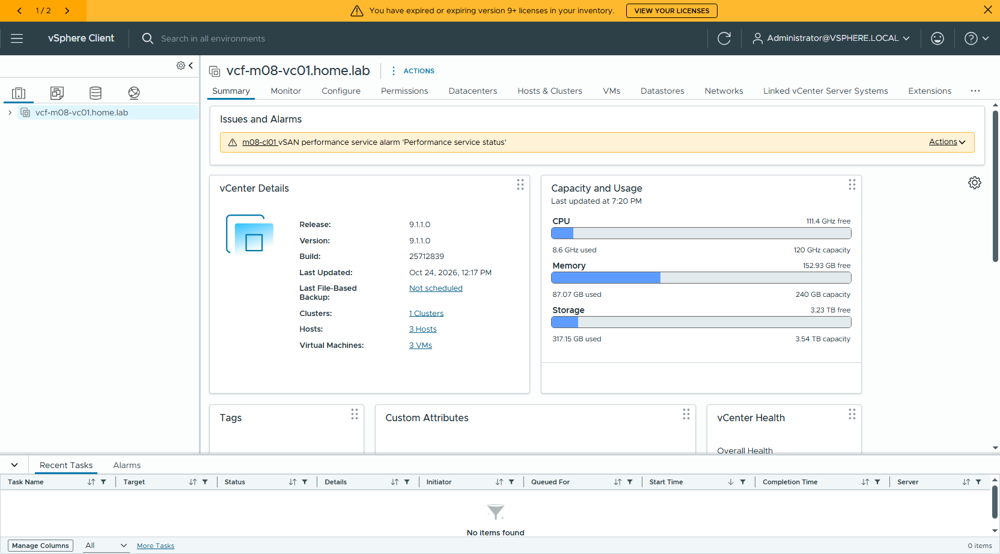

## 7. P5 — cluster 轉 vLCM single-image（UI）

9.1.1 的 REST 沒有 enablement 的 enable 動作，要走 UI。

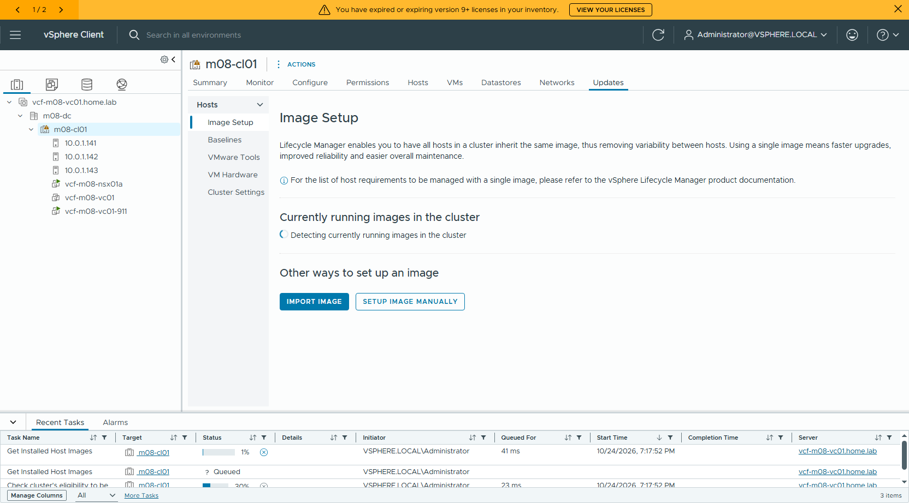

偵測到 host 現行映像 ESXi 8.0U3b → **PROCEED WITH THIS IMAGE**：

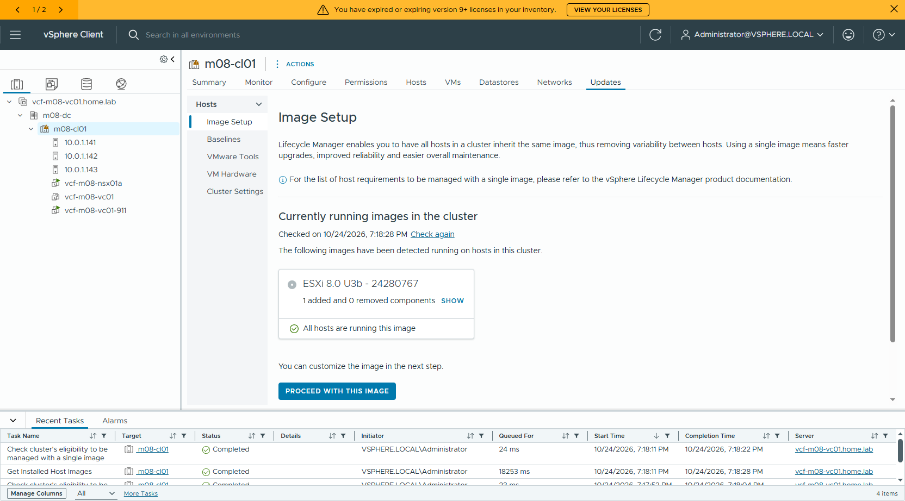

Step 1 Define Image → **SAVE**（自動命名 autogen-software-spec-1）：

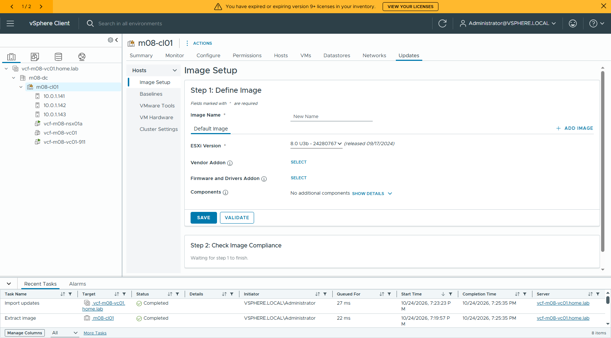

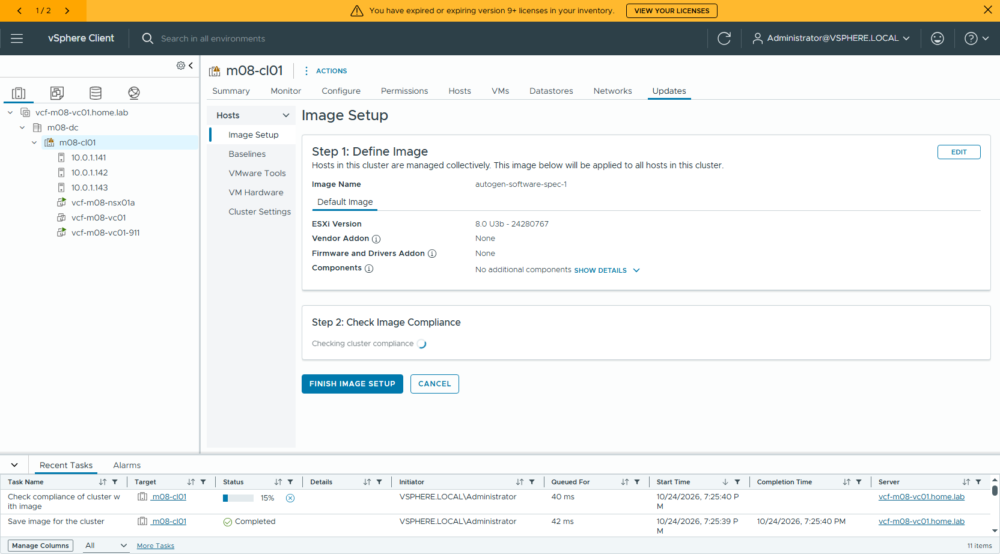

Step 2 compliance 完成 → **FINISH IMAGE SETUP**：

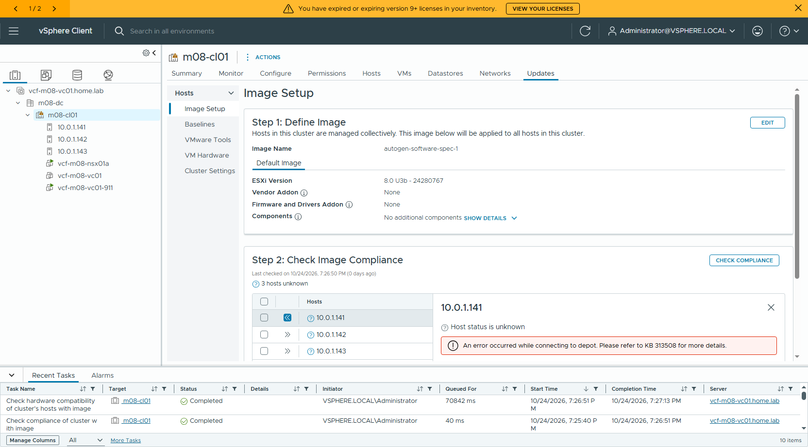

確認框 → **YES, FINISH IMAGE SETUP**（不可逆，之後無法回到 baseline）：

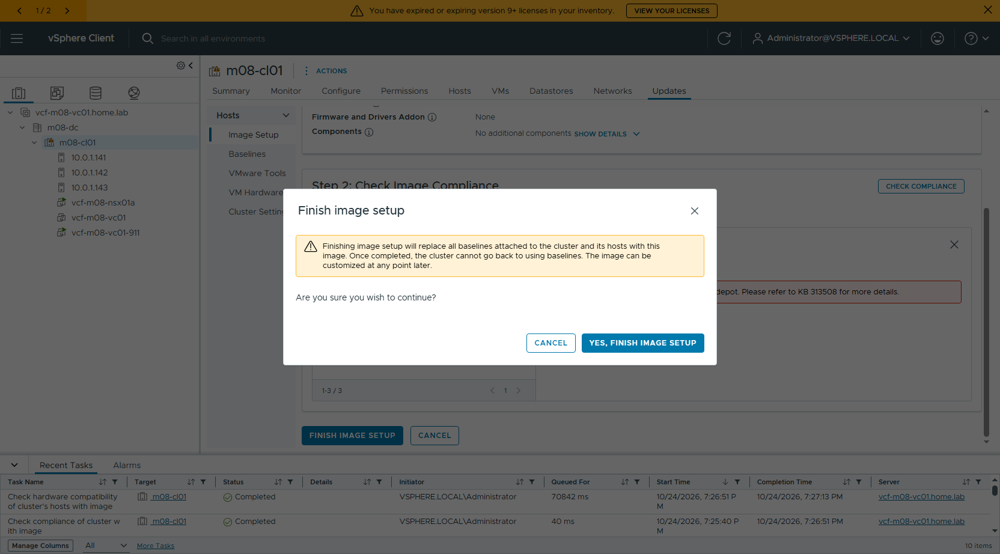

驗證：`GET /api/esx/settings/clusters/domain-c9/enablement/software` → `{"enabled": true}`。

## 8. P6 — converge

### 8.1 Installer 與 bundle
- 部 VCF Installer 9.1.1 到 10.0.1.155（`Deploy-M08-Installer.ps1`）。
- 設定 offline depot（API）：
  `PUT /v1/system/settings/depot` → `{"depotConfiguration":{"isOfflineDepot":true,"url":"http://10.0.0.61:8888"}}`，回 `DEPOT_CONNECTION_SUCCESSFUL`。
- 下載 bundle：`PATCH /v1/bundles/{id}` → `{"bundleDownloadSpec":{"downloadNow":true}}`（回 202）。本次下載 15 個、約 52 GB，跳過 NSX_ALB、HCX、VRA。
  > 批次送出時要逐筆確認 HTTP 202，第一次批次其實沒有生效。

### 8.2 用 API 預檢，抓到 m07 沒遇過的問題

**1. `Host name is not a FQDN`**

P2 時是用 IP 把 host 加進 vCenter。ESXi 本身的 hostname 是對的，問題在 vCenter inventory 名稱，而 vSphere 無法改 host 名稱，只能逐台重加（`scripts/Readd-HostFqdn.ps1`）：

1. 進維護（vSAN EnsureAccessibility）
2. 移出 cluster（NSX TNC 會自動 unprep）
3. 移出 VDS
4. 從 vCenter 移除
5. 用 FQDN 加到 datacenter
6. 加回 VDS + vmnic1
7. 移進 cluster（NSX 重新 prep）
8. 退維護

> 直接 Remove 會被擋："host is part of VDS"（這個 VDS 同時是 NSX 的 host switch）。

**2. host DNS 順序造成 NSX prep 失敗（26019 "connecting to depot"）**

host 的 DNS 是 `10.0.0.1, 10.0.0.200`。router 10.0.0.1 對 home.lab 回 NXDOMAIN，resolver 就不會再問第二台，所以 host 解析不到 vCenter FQDN，也就抓不到 vLCM depot（`http://vcf-m08-vc01.home.lab:9084/vum/repository/`）。

修法：`esxcli network ip dns server remove --server 10.0.0.1`，然後讓 TNC retry。

> P2 時是 baseline 模式，由 NSX 直接推 VIB，不需要 FQDN，所以當時沒出事；P5 轉成 vLCM 後才會出事。

**3. `VMKernel adapter management / vmotion is not assigned to a dedicated port group`**

vmk0 同時負責 mgmt + vMotion + vSAN，而且在 standard vSwitch 上。依 KB 430625，Management、vMotion、vSAN 要各自在 VDS 上的專屬 dvPortgroup。

（其餘：Deployment Spec / Security / DNS / Versions and Bundles / Password / Network 全部通過；capacity 有 2 個 warning，不影響。）

### 8.3 vmk 重構（KB 430625）

| vmk | 服務 | 改後位置 | IP |
|---|---|---|---|
| vmk0 | Management | `m08-vds01-pg-mgmt`（連同 vmnic0 一起搬上 VDS） | 10.0.1.141–143 |
| vmk1 | vMotion | `m08-vds01-pg-vmotion`（新建） | 192.168.174.11–13 |
| vmk2 | vSAN | `m08-vds01-pg-vsan`（新建） | 192.168.178.11–13 |

步驟：

1. VDS 新增 `pg-vmotion`、`pg-vsan`；三個 PG 的 teaming 設成 dvUplink1 active、dvUplink2 unused、Explicit failover。
2. 每台 host 新增 vmk1（vMotion）、vmk2（vSAN），確認 vSAN 已改走 vmk2 後，再把 vmk0 上的 vMotion / vSAN 勾掉。
3. vSwitch0 上只剩 vmk0（所有 VM 早就在 `pg-mgmt`），用 `scripts/Migrate-Vmk0-ToVds.ps1` 一次呼叫把 vmnic0 + vmk0 搬上 VDS（`Add-VDSwitchPhysicalNetworkAdapter -VMHostVirtualNic vmk0 -VirtualNicPortgroup pg-mgmt`）。三台搬完都維持 Connected。

> 🔴 **坑：vSAN 網段撞到 router 的 proxy-ARP。** vmk2 一開始用 192.168.175.11–13，vSAN 立刻分裂（members = 1）。改 teaming 沒用。在 host 上 tcpdump 發現 esx02 把 ARP 回給 router 的 MAC `00:50:56:8e:2e:f9`：lab router（RouterOS 10.0.1.254）對 192.168.175.0/24 有介面並做 proxy-ARP。vmk2 改用 192.168.178.x 後，full-mesh vmkping 正常，vSAN members 3、40 個 object 全部 healthy。
> **教訓：** nested 環境走 trunk 的「純 L2」網段，事先要確認 router 在該 subnet 沒有介面或 proxy-ARP。

結果截圖：

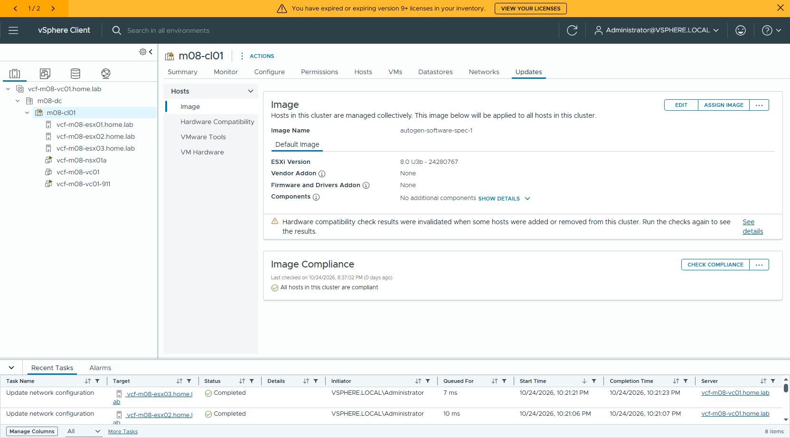

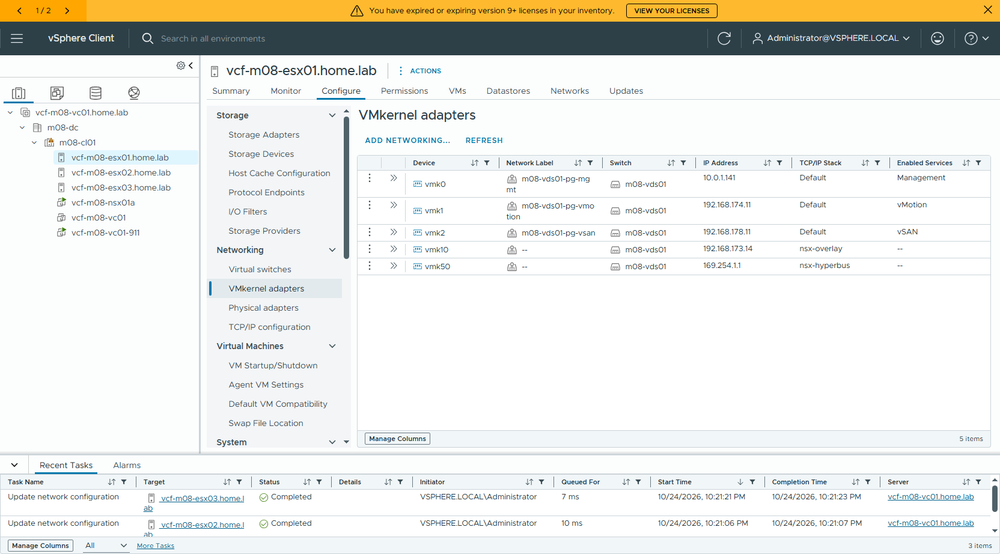

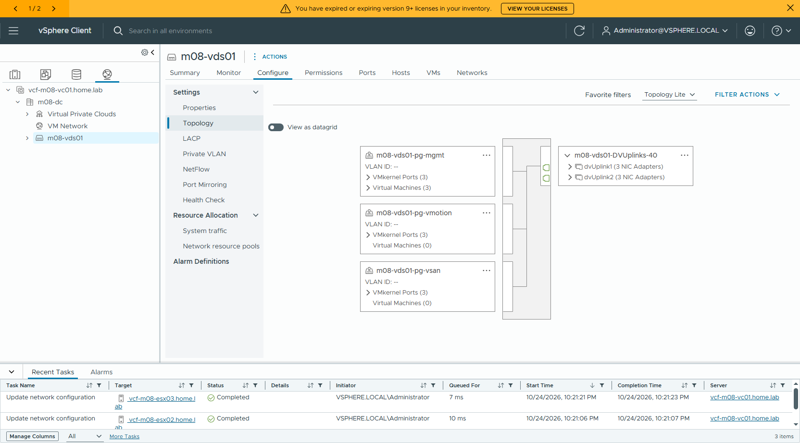

API 再預檢：**COMPLETED / WARNING**，剩下的 warning 都不擋：

- cluster 的 "Evacuate Offline VMs" upgrade policy 與 SDDC Manager 預設不同
- 建議 53 cores
- 儲存帳面 3280 GB < 4364 GB（thin provisioning，實耗遠低於帳面）

### 8.4 UI 送出 converge（Deploy using JSON spec）

1. Installer 首頁 → **DEPLOY USING JSON SPEC**。

   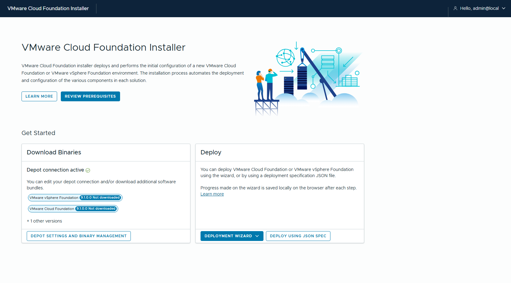

2. **CHOOSE FILE** 選 `converge-m08-spec.json`，Summary 會列出 spec 內容（版本 9.1.1.0、instance `vcf-m08-converge`、domain `vcf-m08`）。

   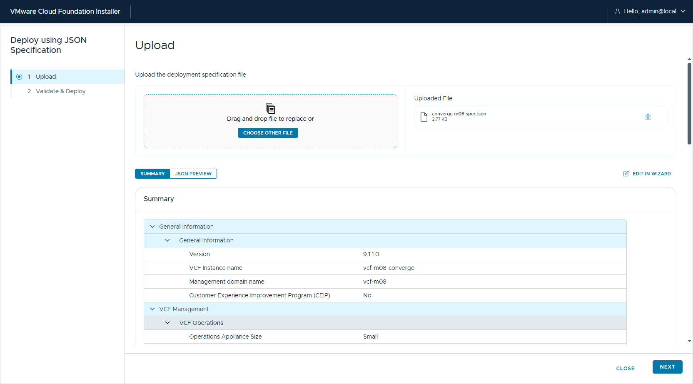

3. **NEXT** → 開始 validation（約 5 分鐘）。結果與 API 預檢一致：只剩 Existing Components、Capacity 兩個 warning。

   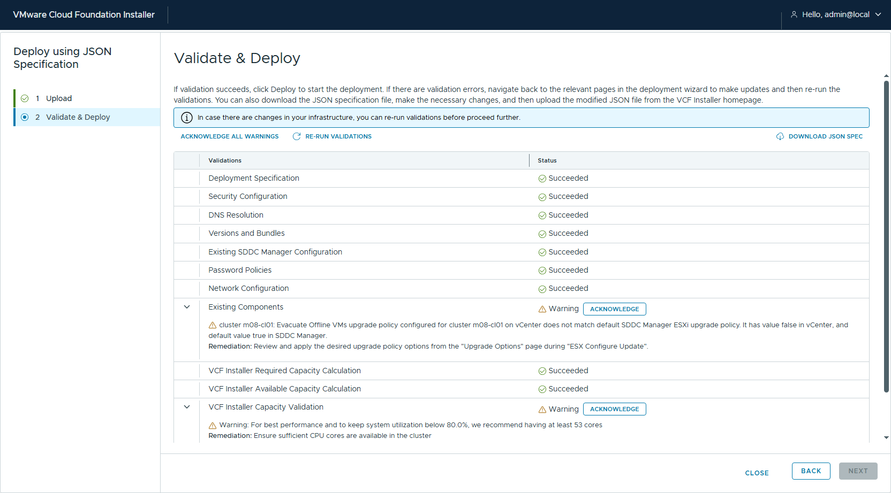

4. **ACKNOWLEDGE ALL WARNINGS** → **NEXT** 送出。

   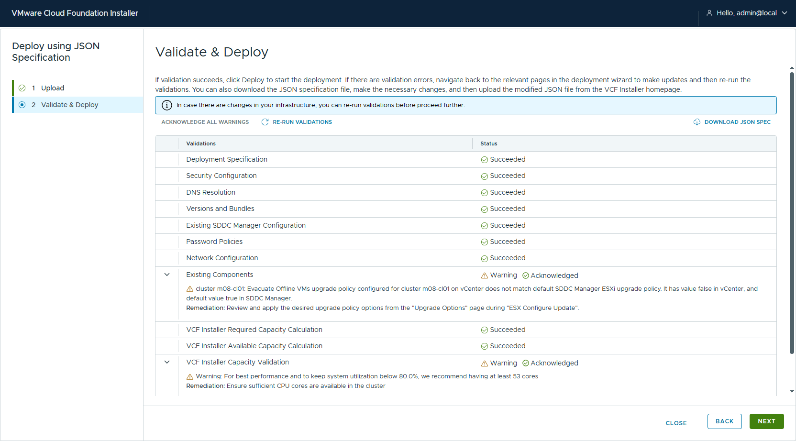

5. 進入進度頁：5 個 milestone、134 個 subtask（16 + 44 + 40 + 15 + 19）。

   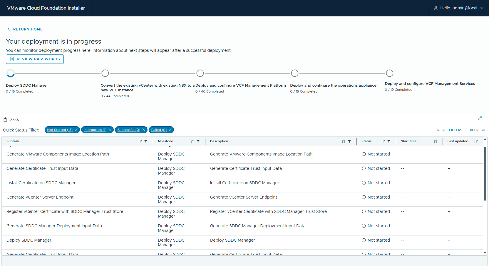

### 8.5 部署進度與結果

2026-10-24 22:38 送出，2026-10-25 08:28 完成，總共約 **9 小時 50 分**。最後一個 milestone 實際是 18 個 subtask（送出時顯示 19），所以總數是 **133/133**，0 failed。

| # | Milestone | subtask | 耗時 |
|---|---|---|---|
| 1 | Deploy SDDC Manager | 16 | 1h 09m |
| 2 | **Convert the existing vCenter with existing NSX to a new VCF instance** | 44 | **8m 29s** |
| 3 | Deploy and configure VCF Management Platform（VSP） | 40 | 4h 50m |
| 4 | Deploy and configure the operations appliance（VCF Ops + collector） | 15 | 1h 44m |
| 5 | Deploy and configure VCF Management Services（Fleet / Salt 等） | 18 | 1h 54m |

真正「把既有 vCenter + NSX 收進 VCF」的 milestone 2 只花 8 分鐘；時間幾乎都花在部新的管理元件（VSP、VCF Ops）。nested 環境 CPU 超配，這幾段會比實機慢很多。

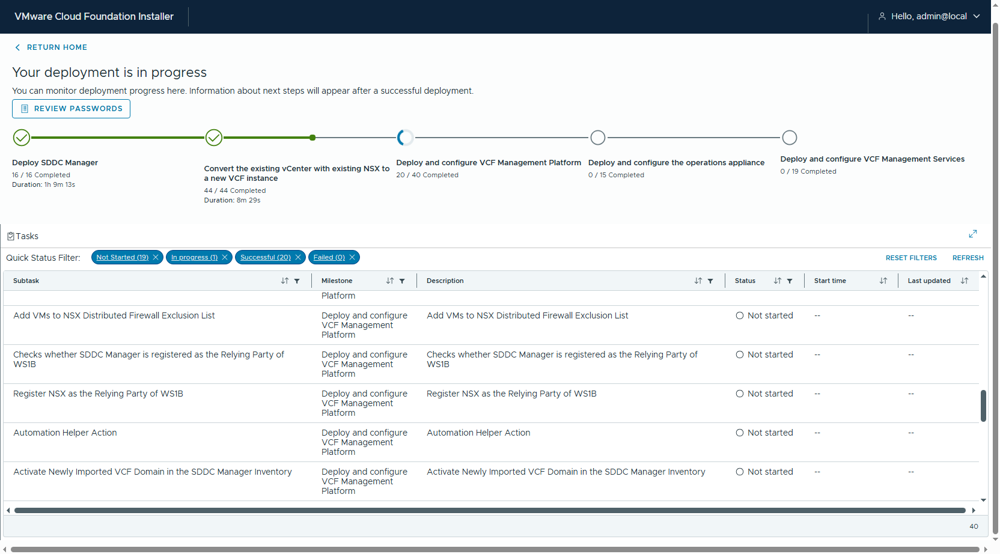

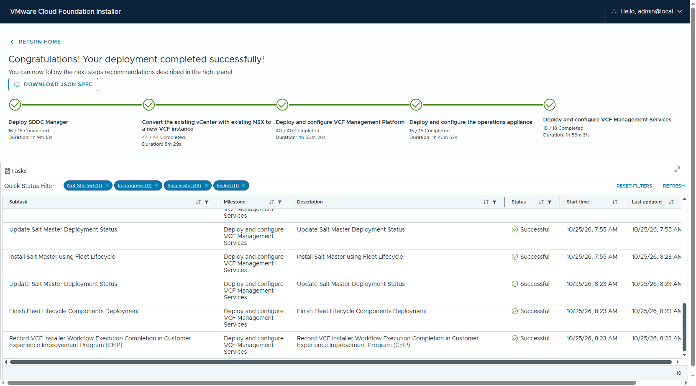

**SDDC Manager API 驗證**（`converge-result-api.txt`）：

| 項目 | 結果 |
|---|---|
| Domain | `vcf-m08` MANAGEMENT **ACTIVE** |
| vCenter | vcf-m08-vc01.home.lab **9.1.1.0.25712839** |
| NSX | vcf-m08-nsx01.home.lab **9.1.1.0.25691509** ACTIVE |
| Cluster | m08-cl01，vsanDatastore，image-based = true，3 hosts |
| ESXi ×3 | **8.0.3-24280767**（ASSIGNED）← 沒有升級 |
| SDDC Manager | vcf-m08-sddcm01.home.lab 9.1.1.0.25713928 |

### 8.6 結論

**只升 vCenter + NSX 到 9.1.1、ESXi 留在 8.0U3b，可以直接 converge 成 VCF 9.1.1 管理網域。** ESXi 之後再由 SDDC Manager / vLCM 升級即可。

前提是 converge 前先把以下幾件事做好（m08 每一項都實際踩過）：

1. NSX 先升（MP → Host → Edge），**逐台確認 host 已退出維護模式**，再升 vCenter（RDU），最後 NSX finalize。
2. cluster 轉 vLCM single-image（用 host 現行 8.0U3b 映像即可，不需 remediation）。
3. vCenter inventory 中的 host 名稱必須是 **FQDN**（不能用 IP 加入）。
4. host DNS 只指向能解析 lab domain 的 DNS（vLCM 模式下 NSX host prep 要解析 vCenter FQDN）。
5. Management / vMotion / vSAN vmk 各在 VDS 上的專屬 dvPortgroup；vCenter / NSX VM 也要在 VDS portgroup 上。
6. NSX 9.1.1 升級預檢的 31944 用 `watermark-curl.sh post` 處理。

## 9. 坑總整理

| # | 階段 | 症狀 | 根因 / 修法 |
|---|---|---|---|
| 1 | P2 | vSAN add disk："SSD can not be used as HDD" | all-flash 先 `tag add -t capacityFlash` |
| 2 | P2 | esx01 加不進 cluster："vSAN UUID mismatch" | 先加 esx01（有 vSAN），再加其他 host |
| 3 | P2 | 誤選開機碟當 cache | 依大小挑（60/1200 GB），排除約 16 GB 開機碟 |
| 4 | P2 | TNP："IP pool of type null" | TEP pool 尚未 realize，稍等再建 |
| 5 | P3 | 標準 NSX 預檢 31944 | `watermark-curl.sh post` |
| 6 | P3 | "bundle not found" | `.mub` 後要再 `upgrade_uc` |
| 7 | P3 | 30955 service account | compute manager `create_service_account` + 帳密 |
| 8 | P3 | Finalize 36013 | 先升 vCenter 9.1.1 |
| 9 | P4 | RDU 一直 `target_unable_to_deploy` | **esx03 卡在維護模式**（NSX host 升級遺留）；要看 `InMaintenanceMode` |
| 10 | P4 | RDU precheck critical alarm | ack 不夠，要讓它不再是紅色 |
| 11 | P5 | UI 按鈕點了沒反應 | Clarity 需真實滑鼠點擊並先 scroll into view；DOM dispatchEvent 無效 |
| 12 | P6 | Host name is not a FQDN | 用 FQDN 重加 host（見 8.2） |
| 13 | P6 | NSX prep 26019 | host DNS 移除 10.0.0.1 |
| 14 | P6 | vmk 未分 dedicated PG | vmk0/vmk1/vmk2 各放 VDS 專屬 dvPortgroup，vmnic0+vmk0 一起搬上 VDS（KB 430625） |
| 15 | P6 | vSAN vmk 改網段後叢集分裂 | router 對 192.168.175.0/24 做 proxy-ARP；換成 router 沒有的網段（192.168.178.x） |
